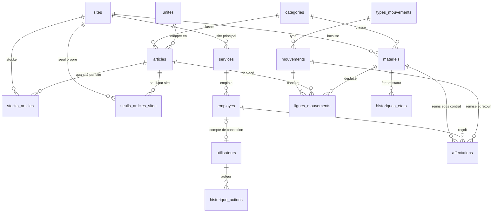
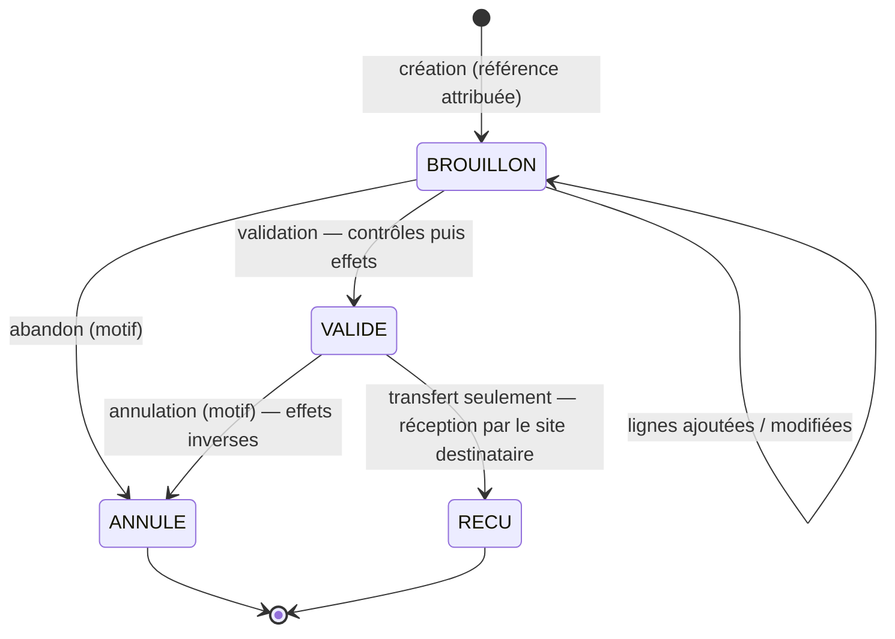

# Dictionnaire de données

**Gestion des matériels et des articles** — schéma version 0001 du 10/11/2026, révisé le 11/11/2026 après validation des choix de gestion (§ 12)
Fichier de création : [`database/schema.sql`](../database/schema.sql) · Contrôles : [`database/tests/test_regles.sql`](../database/tests/test_regles.sql)

---

## 1. Vue d'ensemble

La base compte **22 tables** (21 dans `schema.sql`, plus `signalements` ajoutée par la migration `0002`) et **11 vues** (10, plus `v_reparations_en_cours` ajoutée par la migration `0003`). Elle tourne sur PostgreSQL 16 ou plus (Neon), sans module complémentaire.

| Groupe | Tables |
|---|---|
| Référentiels | `roles`, `sites`, `services`, `categories`, `unites`, `types_mouvements`, `parametres` |
| Personnes | `employes`, `utilisateurs` |
| Biens | `materiels`, `articles`, `seuils_articles_sites`, `stocks_articles` |
| Mouvements | `mouvements`, `lignes_mouvements` |
| Affectations | `affectations`, `signalements` |
| Historiques | `historiques_etats`, `historique_actions` |
| Technique | `compteurs`, `sessions`, `schema_migrations` |



**Principe.** La base garde elle-même les règles qui ne doivent jamais être enfreintes :

- codes uniques ;
- stock jamais négatif ;
- mouvement validé intouchable ;
- une seule affectation en cours par matériel ;
- **statut et site des matériels tenus par les mouvements et les affectations** ;
- historique des états.

Le serveur Express ajoute les droits et les contrôles de saisie. Il ne peut pas contourner ces règles, même par une erreur de programmation.

---

## 2. Conventions

| Sujet | Règle |
|---|---|
| Noms | Français, minuscules, sans accent : `date_mouvement`, `cree_par`. |
| Identifiants | `id bigint` auto-incrémenté sur chaque table (sauf référentiels à code). |
| Codes | Majuscules, uniques. Laissés vides, ils sont générés : `MAT-2026-0001`, `ART-2026-0001`, `MVT-2026-000001`. Un code saisi à la main est mis en majuscules ; le générateur saute les numéros déjà pris. Le code matériel est celui **imprimé en code-barres** sur l'étiquette. |
| Dates | `timestamptz` pour l'horodatage (instant exact), `date` pour la date de gestion (mouvement, remise, retour, réception). La « date du jour » suit le paramètre `fuseau_horaire` (Indian/Antananarivo), pas l'horloge du serveur. |
| Antidatage | Aucune limite dans le passé ; une date future est refusée. Tout mouvement de matériel porte le **n° du ticket** qui le justifie. |
| Quantités | `numeric(14,3)`. Chaque unité fixe ses décimales autorisées : 0 pour pièce, boîte, rame… ; 3 pour litre et kilogramme ; 2 pour mètre. |
| Montants | **Ariary entiers** (`bigint`) : un prix avec décimales est refusé. |
| Suppression | Rien de ce qui trace ne se supprime : mouvements (même en brouillon), affectations, historiques. Un référentiel se désactive (`actif = false`). Un article ou un matériel déjà utilisé est protégé par les clés étrangères. |
| Auteur | Toute écriture sensible exige `app.utilisateur_id` (voir § 7). Les colonnes `cree_par`, `modifie_par`, `valide_par`, `recu_par`, `annule_par`, `remis_par` et `auteur_id` se remplissent seules à partir de lui. |
| Fichiers | Photos, justificatifs et décharges signées : seulement un lien (`*_url`) vers un stockage externe. Rien sur le disque de Render, qui est effacé à chaque redémarrage. |

---

## 3. Tables

Légende : **O** = obligatoire · *auto* = rempli par la base.

### 3.1 `parametres` — réglages de l'application

| Colonne | Type | O | Règle |
|---|---|---|---|
| `cle` | text | O | Clé primaire. |
| `valeur` | text | O | Contrôlée selon la clé (fuseau existant, préfixe de 2 à 6 majuscules, entier). |
| `description` | text | O | |
| `modifie_par`, `modifie_le` | bigint, timestamptz | | Dernière modification. |

Valeurs livrées :

| Clé | Valeur |
|---|---|
| `nom_societe` | à renseigner |
| `fuseau_horaire` | Indian/Antananarivo |
| `devise` | MGA |
| `prefixe_materiel` | MAT |
| `prefixe_article` | ART |
| `prefixe_mouvement` | MVT |
| `connexion_tentatives_max` | 5 |
| `connexion_verrouillage_minutes` | 15 |
| `signalements_actifs` | non (migration `0002` ; `oui` ou `non`) |
| `alerte_transfert_jours` | 3 (migration `0003`) — alerte quand un transfert est en route depuis ce nombre de jours ou plus |
| `alerte_reparation_jours` | 30 (migration `0003`) — alerte quand un matériel est en réparation depuis ce nombre de jours ou plus |
| `alerte_retour_jours` | 7 (migration `0003`) — annonce des retours d'affectation prévus d'ici ce nombre de jours |

Les trois délais d'alerte sont des nombres entiers de jours, de 0 (alerte immédiate) à 365.

Modifiables depuis **Paramètres › Réglages de l’application** : `nom_societe`, `signalements_actifs`, `connexion_tentatives_max`, `connexion_verrouillage_minutes` et les trois délais d'alerte. Les autres sont figés (ils entrent dans les codes et les dates déjà enregistrés).

### 3.2 `roles` — profils d'accès

| Code | Libellé | Rôle (cahier des charges § 1.3) |
|---|---|---|
| `ADMIN` | Administrateur | Paramétrage, comptes, droits, accès complet |
| `GESTIONNAIRE` | Gestionnaire de matériels | Fiches, saisie et validation des mouvements, affectations, inventaires |
| `RESPONSABLE_SERVICE` | Responsable de service | Biens de son service, validation selon droits |
| `EMPLOYE` | Employé | Ses matériels affectés, signalement d'un retour ou d'un problème |

Le détail des droits de chaque rôle est tenu par le serveur (`middleware/permissions.js`, phase 4).

### 3.3 `sites` — sites et magasins

| Colonne | Type | O | Règle |
|---|---|---|---|
| `id` | bigint | O | *auto* |
| `code` | text | O | Unique, 1 à 20 caractères `A-Z 0-9 _ -` (ex. `SIEGE`, `DEPOT`). |
| `nom` | text | O | Unique (sans tenir compte de la casse). |
| `adresse` | text | | |
| `actif` | boolean | O | Défaut vrai. |
| `cree_le` | timestamptz | O | *auto* |

### 3.4 `services` — services de la société

Mêmes colonnes que `sites`, plus `site_id` (site principal du service, facultatif).

### 3.5 `categories`

| Colonne | Type | O | Règle |
|---|---|---|---|
| `id` | bigint | O | *auto* |
| `nom` | text | O | Unique par type. |
| `type` | text | O | `MATERIEL` ou `ARTICLE`. Un matériel ne peut pas être rangé dans une catégorie d'articles, et inversement. |
| `description` | text | | |
| `actif` | boolean | O | |

Catégories livrées (modifiables) :

- **Matériels** : Informatique, Téléphonie, Mobilier, Véhicule, Équipement technique.
- **Articles** : Fournitures de bureau, Consommables informatiques, Produits d'entretien.

### 3.6 `unites` — unités de mesure

| Code | Libellé | Symbole | Décimales |
|---|---|---|---|
| `PIECE` | Pièce | pce | 0 |
| `BOITE` | Boîte | bte | 0 |
| `PAQUET` | Paquet | pqt | 0 |
| `RAME` | Rame | rame | 0 |
| `CARTON` | Carton | ctn | 0 |
| `ROULEAU` | Rouleau | rlx | 0 |
| `LITRE` | Litre | L | 3 |
| `KG` | Kilogramme | kg | 3 |
| `METRE` | Mètre | m | 2 |

Une quantité qui dépasse les décimales de son unité est refusée (2,5 boîtes → erreur GM005).

### 3.7 `types_mouvements` — voir § 4

### 3.8 `employes`

| Colonne | Type | O | Règle |
|---|---|---|---|
| `id` | bigint | O | *auto* |
| `matricule` | text | O | Unique. |
| `nom` | text | O | |
| `prenoms`, `fonction` | text | | |
| `service_id`, `site_id` | bigint | | Rattachement. |
| `telephone`, `email` | text | | Données personnelles limitées au nécessaire (cahier des charges § 8.3). |
| `actif` | boolean | O | Un employé inactif ne reçoit plus de matériel. |
| `cree_le`, `modifie_le` | timestamptz | O | *auto* |

### 3.9 `utilisateurs` — comptes de connexion

| Colonne | Type | O | Règle |
|---|---|---|---|
| `id` | bigint | O | *auto* |
| `nom` | text | O | |
| `email` | text | O | Unique (sans tenir compte de la casse), format contrôlé. |
| `identifiant` | text | | Connexion par identifiant au lieu de l'e-mail ; unique ; 3 à 40 caractères. |
| `mot_de_passe_hash` | text | O | **Seulement un hash bcrypt (`$2a$`, `$2b$`, `$2y$`) ou Argon2 (`$argon2id$`…)** : un mot de passe en clair est refusé par la base. |
| `role_code` | text | O | → `roles`. |
| `statut` | text | O | `ACTIF`, `SUSPENDU`, `DESACTIVE`. Un compte ne se supprime pas. |
| `employe_id` | bigint | | Obligatoire pour le rôle Employé ; un seul compte par employé. |
| `service_id` | bigint | | Obligatoire pour le rôle Responsable de service (son périmètre). |
| `doit_changer_mot_de_passe` | boolean | O | Défaut vrai (premier mot de passe donné par l'administrateur). |
| `tentatives_echouees` | smallint | O | Compteur pour le verrouillage temporaire. |
| `verrouille_jusqu_a` | timestamptz | | |
| `derniere_connexion`, `mot_de_passe_change_le` | timestamptz | | |
| `cree_le`, `modifie_le` | timestamptz | O | *auto* |

### 3.10 `materiels` — matériels durables (suivi à l'unité)

| Colonne | Type | O | Règle |
|---|---|---|---|
| `id` | bigint | O | *auto* |
| `code` | text | O | Unique, *auto* si vide (`MAT-2026-0001`). Imprimé en code-barres. **Ne se modifie plus** après création. |
| `designation` | text | O | |
| `categorie_id` | bigint | O | Catégorie de type `MATERIEL` uniquement. |
| `categorie_type` | text | O | Toujours `MATERIEL` (sert au contrôle ci-dessus). |
| `marque`, `modele` | text | | |
| `numero_serie` | text | | Unique s'il est renseigné (sans tenir compte de la casse). |
| `date_achat` | date | | |
| `prix_achat` | bigint | | Ariary entiers, ≥ 0. |
| `fournisseur` | text | | |
| `site_id` | bigint | O | Localisation actuelle. **Ne change que par la réception d'un transfert ou un retour d'affectation.** |
| `service_id` | bigint | | Service utilisateur. |
| `etat` | text | O | État physique : `NEUF`, `BON`, `MOYEN`, `ENDOMMAGE`, `HORS_SERVICE`. Défaut `BON`. |
| `statut` | text | O | Situation : `DISPONIBLE`, `AFFECTE`, `EN_REPARATION`, `EN_TRANSIT`, `PERDU`, `REFORME` (§ 6). |
| `etiquette_imprimee_le` | timestamptz | | Dernière impression de l'étiquette code-barres. |
| `photo_url` | text | | Lien externe. |
| `observations` | text | | |
| `cree_par`, `cree_le` | | O | *auto*, ne se modifient pas. |
| `modifie_par`, `modifie_le` | | | *auto* à chaque modification. |

Règles :

- Une fiche se crée **disponible** ou **en réparation**.
- Un matériel **hors service** ne peut être ni disponible ni affecté.
- Chaque création et chaque changement d'état ou de statut s'inscrit dans `historiques_etats` (§ 3.18).
- Le responsable du moment et son contrat se lisent dans la vue `v_materiels`.

### 3.11 `articles` — articles consommables (suivi en quantité)

| Colonne | Type | O | Règle |
|---|---|---|---|
| `id` | bigint | O | *auto* |
| `code` | text | O | Unique, *auto* si vide (`ART-2026-0001`). Ne se modifie plus. |
| `designation` | text | O | **Unique** (sans tenir compte de la casse ni des espaces autour). |
| `categorie_id` | bigint | O | Catégorie de type `ARTICLE` uniquement. |
| `unite_code` | text | O | → `unites`. **Figée** dès que l'article a un mouvement (GM012). |
| `seuil_minimum` | numeric(14,3) | O | **Seuil global, à saisir pour chaque article**, comparé au stock de tous les sites. 0 = choix explicite de ne pas suivre de seuil. |
| `site_stockage_id` | bigint | | Magasin habituel. |
| `emplacement` | text | | Rayon, étagère… |
| `actif` | boolean | O | |
| `observations` | text | | |
| `cree_par`, `cree_le`, `modifie_par`, `modifie_le` | | | Comme pour les matériels. |

### 3.12 `seuils_articles_sites` — seuil propre à un site (facultatif)

| Colonne | Type | O | Règle |
|---|---|---|---|
| `article_id`, `site_id` | bigint | O | Clé primaire commune. |
| `seuil_minimum` | numeric(14,3) | O | > 0. Pour ne plus suivre un site, on supprime la ligne. |
| `modifie_par`, `modifie_le` | | O | *auto* |

Ce seuil s'ajoute au seuil global. Un site qui a un seuil mais aucun stock est signalé en rupture.

### 3.13 `stocks_articles` — quantité disponible par article et par site

| Colonne | Type | O | Règle |
|---|---|---|---|
| `article_id`, `site_id` | bigint | O | Clé primaire commune. |
| `quantite` | numeric(14,3) | O | **Jamais négative.** |
| `modifie_le` | timestamptz | O | *auto* |

Cette table est tenue **par la base seule** : validation, annulation et réception des mouvements. Toute écriture directe est refusée (GM002). Une quantité en route entre deux sites n'est dans aucune ligne : elle se lit dans `v_transferts_en_route`. La vue `v_controle_stocks` recalcule le stock à partir des mouvements et doit toujours être vide.

### 3.14 `mouvements` — en-tête d'un mouvement

| Colonne | Type | O | Règle |
|---|---|---|---|
| `id` | bigint | O | *auto* |
| `reference` | text | O | *auto* à la création : `MVT-2026-000001`. Ne se modifie pas. |
| `type_code` | text | O | → `types_mouvements` (§ 4). |
| `date_mouvement` | date | O | Défaut : date du jour. Pas de date future. Pour un transfert : date d'envoi. |
| `statut` | text | O | `BROUILLON` → `VALIDE` → `ANNULE` (§ 5). |
| `motif` | text | selon type | Au moins 3 caractères quand il est exigé. |
| `numero_ticket` | text | selon type | **N° du ticket justificatif, obligatoire dès qu'un matériel est déplacé** (transfert, affectation, retour, perte, mise au rebut). |
| `reference_externe` | text | | N° de bon de livraison, de facture, de bon de sortie. |
| `origine` | text | | Fournisseur ou donateur (entrées). |
| `employe_beneficiaire_id` | bigint | selon type | Bénéficiaire employé. |
| `service_beneficiaire_id` | bigint | selon type | Bénéficiaire service. |
| `justificatif_url` | text | | Pièce jointe externe. |
| `mouvement_corrige_id` | bigint | | Pour un mouvement inverse : le mouvement validé qu'il corrige. |
| `autorise_par` | bigint | selon type | Qui autorise une correction d'inventaire ou un mouvement inverse : **un administrateur, ou un gestionnaire autre que l'auteur** (GM013). |
| `cree_par`, `cree_le` | | O | *auto* |
| `valide_par`, `valide_le` | | | *auto* à la validation (pour un transfert : l'envoi). |
| `date_reception`, `recu_par`, `recu_le` | | | *auto* à la réception d'un transfert. |
| `motif_ecart` | text | si manquant | Obligatoire quand la quantité reçue est inférieure à l'envoi. |
| `annule_par`, `annule_le` | | | *auto* à l'annulation. |
| `motif_annulation` | text | à l'annulation | Au moins 3 caractères. |
| `modifie_le` | timestamptz | O | *auto* |

### 3.15 `lignes_mouvements` — biens déplacés par un mouvement

| Colonne | Type | O | Règle |
|---|---|---|---|
| `id` | bigint | O | *auto* |
| `mouvement_id` | bigint | O | Ne change pas. |
| `article_id` | bigint | un des deux | Exactement **un** article **ou** un matériel par ligne. |
| `materiel_id` | bigint | un des deux | Un matériel n'apparaît qu'une fois par mouvement. |
| `quantite` | numeric(14,3) | O | > 0 ; toujours 1 pour un matériel ; décimales selon l'unité de l'article. Pour un transfert : quantité envoyée. |
| `site_source_id` | bigint | selon sens | Site d'origine. Pour un matériel, ce doit être son site actuel. |
| `site_destination_id` | bigint | selon sens | Site de destination, différent de l'origine. |
| `observations` | text | | |
| `quantite_recue` | numeric(14,3) | *auto* | Transfert : quantité arrivée (0 à la quantité envoyée). |
| `materiel_statut_avant` | text | *auto* | Statut du matériel avant l'effet du mouvement, pour le rétablir à l'annulation ou à la réception. |
| `cree_le` | timestamptz | O | *auto* |

Les lignes ne se modifient que tant que le mouvement est en **brouillon**. Les deux colonnes *auto* ne sont jamais saisies. Chaque ligne est contrôlée à la saisie, puis de nouveau à la validation, car le type a pu changer entre-temps.

### 3.16 `affectations` — remise d'un matériel à un employé sous contrat, puis retour

| Colonne | Type | O | Règle |
|---|---|---|---|
| `id` | bigint | O | *auto* |
| `materiel_id` | bigint | O | Doit être **disponible** et en état neuf, bon ou moyen. |
| `employe_id` | bigint | O | Employé actif. |
| `numero_contrat` | text | O | N° du contrat de remise. |
| `date_remise` | date | O | Défaut : date du jour ; pas dans le futur. |
| `date_retour_prevue` | date | O | D'après le contrat ; ≥ date de remise. **Prolongeable** tant que l'affectation est en cours. |
| `etat_remise` | text | O | `NEUF`, `BON` ou `MOYEN`. |
| `remis_par` | bigint | O | *auto* (utilisateur courant). |
| `observations_remise` | text | | |
| `preuve_remise_url` | text | | Décharge signée, sur stockage externe. |
| `mouvement_affectation_id` | bigint | O | Mouvement « Affectation » **validé**, pour ce matériel et cet employé. |
| `date_retour` | date | au retour | ≥ date de remise, pas dans le futur. |
| `etat_retour` | text | au retour | Un des 5 états. |
| `recu_par` | bigint | au retour | *auto* |
| `observations_retour` | text | si abîmé | **Obligatoires** pour un retour endommagé ou hors service ; reprises dans l'historique. |
| `mouvement_retour_id` | bigint | au retour | Mouvement « Retour d'affectation » **validé**, pour ce matériel. Son site de destination devient le site du matériel. |
| `cree_le` | timestamptz | O | *auto* |

Règles :

- **Une seule affectation en cours par matériel** (index unique).
- À la création, la base met le matériel au statut **affecté**.
- Au retour, la base reporte l'état constaté sur la fiche, fixe le statut selon cet état (§ 6) et place le matériel sur le site de retour.
- Les informations de remise ne se modifient pas. Une affectation close est figée, et aucune affectation ne se supprime.

### 3.17 Retards

La vue `v_affectations_en_retard` liste les affectations en cours dont la date de retour prévue est dépassée, avec le nombre de jours de retard. Sur la fiche matériel, la vue `v_materiels` porte aussi un indicateur `retour_en_retard`.

### 3.17 bis `signalements` — problème signalé par un employé sur son matériel (migration `0002`)

| Colonne | Type | O | Règle |
|---|---|---|---|
| `id` | bigint | O | *auto* |
| `materiel_id` | bigint | O | Matériel concerné. |
| `affectation_id` | bigint | | Affectation en cours au moment du signalement (le serveur n'accepte que les matériels affectés à l'auteur). |
| `auteur_id` | bigint | O | *auto* (utilisateur courant). |
| `type` | text | O | `PANNE`, `PERTE`, `RETOUR_SOUHAITE`, `AUTRE`. |
| `description` | text | O | 5 à 2 000 caractères. |
| `statut` | text | O | `OUVERT` à la création, puis `PRIS_EN_CHARGE`, puis `CLOS`. Jamais de retour à `OUVERT`. |
| `cree_le` | timestamptz | O | *auto* |
| `traite_par`, `traite_le` | bigint, timestamptz | | *auto* à chaque changement de statut. |
| `reponse` | text | | Suite donnée, **obligatoire pour clore** ; l'employé la lit dans « Mes matériels ». |

Un signalement ne se supprime pas et ne se vide pas ; sa description ne change plus ; une fois clos, il est figé. Il n'est possible que si le paramètre `signalements_actifs` vaut `oui`.

### 3.18 `historiques_etats` — journal des états et statuts des matériels

| Colonne | Type | O | Règle |
|---|---|---|---|
| `id` | bigint | O | *auto* |
| `materiel_id` | bigint | O | |
| `ancien_etat`, `ancien_statut` | text | | Vides à la création de la fiche. |
| `nouvel_etat`, `nouveau_statut` | text | O | |
| `date_changement` | timestamptz | O | *auto* |
| `auteur_id` | bigint | O | *auto* (utilisateur courant). |
| `commentaire` | text | parfois | **Obligatoire** pour passer à l'état endommagé ou hors service, ou au statut en réparation, perdu ou réformé. Quand le changement vient d'un mouvement ou d'un retour, la base y met le motif, les observations ou la référence du transfert. |

Rempli **automatiquement** par la base. Ni modification, ni suppression, ni vidage (GM010).

### 3.19 `historique_actions` — journal des opérations sensibles

| Colonne | Type | O | Règle |
|---|---|---|---|
| `id` | bigint | O | *auto* |
| `date_action` | timestamptz | O | *auto* |
| `utilisateur_id` | bigint | | Vide pour une tentative de connexion avec un compte inconnu. |
| `action` | text | O | Majuscules : `CONNEXION`, `CONNEXION_ECHEC`, `CREATION`, `MODIFICATION`, `VALIDATION`, `ANNULATION`, `RECEPTION`, `PROLONGATION`, `EXPORT_CSV`, `IMPRESSION_ETIQUETTE`… |
| `entite`, `entite_id` | text, bigint | | Table et ligne concernées. |
| `metadonnees` | jsonb | O | Détails : filtres d'un export, champs modifiés, ancienne date prévue… |
| `adresse_ip` | inet | | |

Écrit par le serveur. Ni modification, ni suppression, ni vidage.

### 3.20 Tables techniques

| Table | Rôle |
|---|---|
| `compteurs` | Dernier numéro attribué par préfixe et par année (`MAT`/2026 → 1, 2, 3…). Deux enregistrements simultanés ne reçoivent jamais le même code. |
| `sessions` | Sessions de connexion stockées en base, au format attendu par `connect-pg-simple` (option `tableName: 'sessions'`). |
| `schema_migrations` | Versions du schéma appliquées (`0001` pour ce fichier, puis `0002` pour les signalements). |

---

## 4. Types de mouvement

**Sens** :

- une **entrée** a un site de destination et pas d'origine ;
- une **sortie** a un site d'origine et pas de destination ;
- un **transfert** a les deux et se fait **en deux temps** : l'envoi retire le bien de l'origine, la réception l'ajoute à la destination.

| Code | Libellé | Sens | Articles | Matériels | Motif | Bénéficiaire | Autorisation | Ticket (matériel) | Saisi depuis |
|---|---|---|:-:|:-:|:-:|:-:|:-:|:-:|---|
| `RECEPTION_ACHAT` | Réception — achat | Entrée | ✓ | ✓ | | | | | Mouvements / fiche matériel |
| `RECEPTION_DON` | Réception — don | Entrée | ✓ | ✓ | | | | | Mouvements / fiche matériel |
| `RETOUR_AFFECTATION` | Retour d'affectation | Entrée | | ✓ | | ✓ | | ✓ | Affectations |
| `CORRECTION_PLUS` | Correction d'inventaire (+) | Entrée | ✓ | | ✓ | | ✓ | | Mouvements |
| `CONSOMMATION` | Consommation / distribution | Sortie | ✓ | | ✓ | ✓ | | | Mouvements |
| `AFFECTATION` | Affectation à un employé | Sortie | | ✓ | ✓ | ✓ | | ✓ | Affectations |
| `PERTE` | Perte | Sortie | ✓ | ✓ | ✓ | | | ✓ | Mouvements |
| `CASSE` | Casse | Sortie | ✓ | | ✓ | | | | Mouvements |
| `MISE_AU_REBUT` | Mise au rebut | Sortie | ✓ | ✓ | ✓ | | | ✓ | Mouvements |
| `CORRECTION_MOINS` | Correction d'inventaire (−) | Sortie | ✓ | | ✓ | | ✓ | | Mouvements |
| `TRANSFERT` | Transfert entre sites | Transfert | ✓ | ✓ | ✓ | | | ✓ | Mouvements |

- Toute sortie exige un motif (cahier des charges § 3.5).
- Le ticket n'est exigé que si le mouvement porte au moins un matériel. Un transfert de papier n'en demande pas.
- La casse d'un **matériel** n'est pas une sortie : c'est un changement d'état (endommagé ou hors service), avec commentaire.

---

## 5. Cycle de vie d'un mouvement



« Reçu » n'est pas une valeur de `statut` : un transfert reçu reste `VALIDE`, avec `recu_le` rempli. Les vues l'affichent `EN_ROUTE` ou `RECU` (`etat_transfert`).

- Un mouvement se crée **toujours en brouillon** ; il ne peut pas naître validé.
- **À la validation**, la base vérifie :
  - au moins une ligne ;
  - pas de date future ;
  - motif, bénéficiaire, autorisation et ticket selon le type ;
  - cohérence de chaque ligne avec le sens ;
  - décimales des quantités ;
  - pour un matériel : qu'il est bien sur le site d'origine, et dans un statut qui permet l'opération.

  Puis elle applique les effets sur le stock des articles et sur la fiche des matériels. Si un contrôle échoue, **tout est refusé** et le mouvement reste en brouillon.
- **Transfert en deux temps** :
  - **Envoi** (validation) : le stock quitte l'origine ; un matériel passe « en transit » et reste rattaché à son site d'origine.
  - **Réception**, avec la fonction `receptionner_transfert`. Le site destinataire indique les quantités arrivées (par défaut, tout). Un manquant exige un motif. Le reçu entre en stock à destination ; le manquant n'entre nulle part et reste tracé dans `v_ecarts_transferts`. Un matériel arrivé change de site et retrouve son statut d'avant. Un matériel non arrivé passe « perdu ».
  - Un transfert **en route** peut être annulé : la marchandise revient à l'origine. Un transfert **reçu** est définitif ; on le corrige par un transfert inverse.
- **Un mouvement validé est figé.** Deux façons de corriger une erreur :
  - **l'annuler**, avec un motif : la base retire ses effets. C'est refusé si la marchandise est déjà ressortie, ou si le matériel a changé de statut depuis ;
  - **passer un mouvement inverse** qui le référence (`mouvement_corrige_id`), autorisé par un administrateur ou un autre gestionnaire.
- Ne s'annulent pas :
  - une réception de matériel : on sort le matériel par une mise au rebut motivée ;
  - une affectation : on enregistre le retour ;
  - un retour enregistré.
- **Aucun mouvement ne se supprime**, même en brouillon : un brouillon abandonné s'annule, avec un motif. La numérotation `MVT-…` reste continue.

**Accès simultanés.** Deux validations qui touchent le même article sur le même site passent l'une après l'autre. Contrôlé le 10/11 et de nouveau le 11/11 sur le schéma révisé : deux sorties de 10 boîtes validées en même temps sur un stock de 15 donnent une sortie acceptée et une refusée (« disponible 5, demandé 10 »). Stock final 5.

---

## 6. Matériels : état, statut, affectations

**État physique** (ce que l'on constate) et **statut** (la situation) sont deux colonnes distinctes.

| État | Signification |
|---|---|
| `NEUF` | Jamais utilisé ou équivalent au neuf |
| `BON` | Fonctionnel, utilisable normalement |
| `MOYEN` | Usure visible, encore utilisable |
| `ENDOMMAGE` | Défaut nécessitant une intervention ou une décision |
| `HORS_SERVICE` | Inutilisable |

| Statut | Signification | Comment on y arrive |
|---|---|---|
| `DISPONIBLE` | Peut être remis à un employé | Création ; à la main depuis « en réparation » ; retour en état neuf, bon ou moyen |
| `AFFECTE` | Remis à un employé sous contrat | Création de l'affectation (par la base) |
| `EN_REPARATION` | Chez le réparateur ou en attente | Création ; à la main depuis « disponible » (avec commentaire) ; retour en état endommagé |
| `EN_TRANSIT` | En route vers un autre site | Envoi d'un transfert (par la base) |
| `PERDU` | Déclaré perdu | Mouvement de perte validé ; matériel non reçu au bout d'un transfert |
| `REFORME` | Sorti définitivement du parc | Mouvement de mise au rebut validé ; retour en état hors service |

**Règle du retour** (décidée le 11/11) :

| État au retour | Statut |
|---|---|
| neuf, bon ou moyen | disponible |
| endommagé | en réparation |
| hors service | réformé |

Les observations sont obligatoires pour un retour endommagé ou hors service.

Garanties par la base :

- **À la main**, un seul changement de statut est permis : de disponible à en réparation, et inversement. Tous les autres viennent d'un mouvement ou d'une affectation. Le site d'un matériel ne se change jamais à la main.
- Un matériel hors service n'est ni disponible ni affecté.
- Seul un matériel disponible, en état neuf, bon ou moyen, peut être affecté.
- Une perte, une mise au rebut ou un transfert est refusé pour un matériel encore affecté : il faut d'abord enregistrer son retour.
- Une seule affectation en cours.
- Chaque changement est historisé avec son auteur, sa date et un commentaire.

---

## 7. Ce que le serveur doit faire

1. **Au début de chaque transaction qui écrit** :
   ```sql
   BEGIN;
   SELECT set_config('app.utilisateur_id', $1, true);   -- id de l'utilisateur connecté
   ```
   Sans cela, la base refuse l'écriture (GM009).
2. **Avant de changer à la main l'état ou le statut d'un matériel**, poser le commentaire saisi :
   `SELECT set_config('app.commentaire', $1, true);`
   Les réglages `gm.*` sont réservés aux fonctions de la base : le serveur ne doit jamais les poser.
3. **Enchaînements**, chacun dans **une seule transaction**. La base s'occupe du stock et de la fiche matériel ; le serveur n'a qu'à enregistrer.

   | Opération | Étapes |
   |---|---|
   | Réception d'un matériel (scénario 4.1) | `INSERT materiels` → `INSERT mouvements` (RECEPTION_ACHAT ou DON) → `INSERT lignes_mouvements` (destination = site de la fiche) → `UPDATE mouvements SET statut = 'VALIDE'` → impression de l'étiquette code-barres |
   | Entrée ou sortie d'articles | `INSERT mouvements` → `INSERT lignes_mouvements` → `UPDATE … statut = 'VALIDE'` |
   | Affectation (scénario 4.2) | Mouvement AFFECTATION (bénéficiaire = l'employé, n° de ticket, ligne : origine = site du matériel) validé → `INSERT affectations` (n° de contrat, date de retour prévue) |
   | Prolongation | `UPDATE affectations SET date_retour_prevue = …` (+ `historique_actions`) |
   | Retour | Mouvement RETOUR_AFFECTATION (n° de ticket, destination = site de retour) validé → `UPDATE affectations SET date_retour, etat_retour, observations_retour, mouvement_retour_id` |
   | Envoi d'un transfert | Mouvement TRANSFERT (motif ; n° de ticket s'il porte un matériel) validé |
   | Réception d'un transfert | `SELECT receptionner_transfert(id, '[{"ligne_id": …, "quantite_recue": …}]', 'motif du manquant')`. Sans liste : tout est reçu. |
   | Perte ou rebut d'un matériel | Mouvement PERTE ou MISE_AU_REBUT (motif, n° de ticket) validé |
   | Réparation | `set_config('app.commentaire', …)` puis `UPDATE materiels SET statut = 'EN_REPARATION'`, et plus tard retour à `DISPONIBLE` (état mis à jour) |
   | Annulation | `UPDATE mouvements SET statut = 'ANNULE', motif_annulation = …` : la base défait le stock et rétablit le statut des matériels |

4. **Garder les transactions courtes.** La ligne du compteur de références reste verrouillée jusqu'à la fin de la transaction qui l'a utilisée.
5. **Traduire les erreurs** de la base en messages pour l'utilisateur (§ 9), dans une fenêtre de l'application, jamais avec `alert()`.
6. **Lire les listes dans les vues** (§ 10), avec `LIMIT` / `OFFSET` pour la pagination. La recherche par scan de code-barres cherche le code saisi dans `materiels.code`.
7. **Inscrire dans `historique_actions`** les connexions et leurs échecs, les validations, les réceptions, les annulations, les prolongations, les exports et les impressions d'étiquettes.

---

## 8. Règles et où elles sont tenues

| Règle | Référence | Tenue par | Comment |
|---|---|---|---|
| Code unique pour chaque matériel et article | CDC § 4.4 | Base | Contrainte unique, mise en majuscules, génération `MAT`/`ART` |
| Désignation d'article unique | CDC § 3.3 | Base | Index unique sans casse |
| Numéro de série unique s'il est renseigné | CDC § 3.2 | Base | Index unique partiel |
| Une sortie ne dépasse pas le stock | CDC § 4.4, test 7 | Base | Contrôle à la validation, verrou de ligne, contrainte « jamais négatif » |
| Un mouvement validé n'est jamais supprimé | CDC § 4.4 | Base | Aucune suppression, aucune modification après validation |
| Correction par annulation tracée ou mouvement inverse autorisé | CDC § 4.4, test 11 | Base | Statut ANNULE + motif ; `mouvement_corrige_id` + `autorise_par` |
| Un transfert ne crée ni ne supprime de stock | CDC § 4.4 | Base | Envoi − origine, réception + destination ; manquant tracé et motivé |
| Réception d'un transfert par le site destinataire | CDC § 3.4, décision 11/11 | Base | `receptionner_transfert`, quantités reçues, motif d'écart |
| Correction d'inventaire avec autorisation et motif | CDC § 3.4, décision 11/11 | Base | Types CORRECTION_* ; administrateur ou autre gestionnaire (GM013) |
| Sortie avec motif, bénéficiaire ou destination, date, utilisateur | CDC § 3.5 | Base | Règles par type, auteur obligatoire |
| Ticket justificatif pour tout mouvement de matériel | Décision 11/11 | Base | `numero_ticket` exigé à la validation |
| Affectation sous contrat, retour prévu, retards signalés | Décision 11/11 | Base | `numero_contrat`, `date_retour_prevue`, `v_affectations_en_retard` |
| Seuil global et seuil par site | CDC § 3.3, décision 11/11 | Base | `articles.seuil_minimum` obligatoire, `seuils_articles_sites`, `v_alertes_stock` |
| Montants en Ariary entiers | Décision 11/11 | Base | `prix_achat bigint` |
| Transaction atomique | CDC § 4.4 | Serveur + base | Les déclencheurs s'exécutent dans la transaction du serveur |
| Dates cohérentes, fuseau choisi | CDC § 4.4 | Base | `timestamptz`, date du jour selon `fuseau_horaire` |
| Auteur et horodatage des opérations sensibles | CDC § 4.4 | Base + serveur | Utilisateur courant obligatoire, colonnes `*_par` / `*_le`, journaux |
| Un matériel affecté ne l'est pas deux fois | CDC § 3.6 | Base | Contrôle de disponibilité + index unique partiel |
| Le retour clôt l'affectation et recalcule le statut | CDC § 3.6, test 9, décision 11/11 | Base | Statut selon l'état constaté, site de retour |
| État et statut séparés, changements datés, signés, commentés | CDC § 3.7, test 10 | Base | Deux colonnes, historique automatique, statut protégé |
| Quantités numériques, unités et arrondis | CDC § 7 | Base | `numeric(14,3)`, décimales par unité |
| Mot de passe jamais en clair | CDC § 7, § 8.1 | Base | Seuls les hash bcrypt / Argon2 sont acceptés |
| Code-barres sur les matériels | CDC § 14, décision 11/11 | Serveur | Étiquette imprimée depuis le code MAT-… (phase 5), `etiquette_imprimee_le` |
| Fichiers hors du disque Render | CDC § 3.2, § 7 | Conception | Colonnes `*_url` vers un stockage externe |
| Droits vérifiés côté serveur | CDC § 1.3, § 8.1 | Serveur | Phase 4 |

---

## 9. Codes d'erreur

Côté Node, le code arrive dans `err.code`.

| Code | Sens | Exemple de message de la base |
|---|---|---|
| `GM001` | Stock insuffisant | Stock insuffisant pour PAPIER-A4 — Papier A4 80 g sur le site SIEGE : disponible 7, demandé 8 |
| `GM002` | Enregistrement figé | Le transfert MVT-2026-000010 est reçu : il ne s'annule plus ; passez un transfert inverse |
| `GM003` | Suppression interdite | Un mouvement ne se supprime jamais : annulez-le avec un motif |
| `GM004` | Ligne incohérente | Le matériel MAT-2026-0001 ne se trouve pas sur le site d'origine indiqué |
| `GM005` | Quantité non conforme à l'unité | Quantité 2.5 refusée pour l'article PAPIER-A4 : 0 décimale(s) au plus |
| `GM006` | Information obligatoire absente | N° de ticket obligatoire pour un mouvement de matériel « Transfert entre sites » |
| `GM007` | Date non valable | La date du mouvement (12/11/2026) est dans le futur · Date de réception avant l'envoi |
| `GM008` | Matériel ou employé indisponible | Le matériel MAT-2026-0001 est au statut AFFECTE : enregistrez d'abord son retour |
| `GM009` | Utilisateur courant non renseigné | (erreur de programmation du serveur) |
| `GM010` | Historique non modifiable | La table historiques_etats est un historique |
| `GM011` | Mouvement sans ligne | Le mouvement MVT-2026-000008 n'a aucune ligne |
| `GM012` | Unité figée | L'unité de l'article PAPIER-A4 est figée : il a déjà des mouvements |
| `GM013` | Autorisation non valable | L'autorisation doit venir d'un administrateur, ou d'un gestionnaire autre que l'auteur |
| `23502` | Champ obligatoire vide (code PostgreSQL) | N° de contrat, date de retour prévue, seuil global… |
| `23505` | Doublon (code PostgreSQL) | Code, désignation, n° de série ou e-mail déjà utilisé ; deuxième affectation en cours |
| `23514` | Règle de contrôle (code PostgreSQL) | Le nom de la contrainte indique la règle : `materiels_hors_service_inutilisable`, `affectations_prevue_apres_remise`, `lignes_quantite_recue`… |
| `23503` | Référence invalide (code PostgreSQL) | Catégorie d'un autre type, site inexistant… |
| `22P02` | Valeur mal formée (code PostgreSQL) | Prix avec décimales, nombre illisible |

---

## 10. Vues

| Vue | Contenu | Écran ou rapport |
|---|---|---|
| `v_materiels` | Matériel + catégorie, site, service, **responsable, n° de contrat, retour prévu, retard**, date d'étiquette | Liste et fiche matériel, rapports « État du parc », « Affectations en cours » |
| `v_affectations_en_retard` | Affectations en cours dont le retour prévu est dépassé, jours de retard | Tableau de bord, rapport « Retours » |
| `v_transferts_en_route` | Lignes envoyées et pas encore reçues, jours en route | Écran de réception du site destinataire, tableau de bord |
| `v_ecarts_transferts` | Manquants constatés à la réception, avec motif | Rapport « Anomalies » |
| `v_stock_articles` | Stock disponible total, **quantité en route**, `en_rupture`, alerte sur le seuil global | Liste des articles, rapport « Stock articles » |
| `v_stock_articles_sites` | Stock par article et par site, seuil du site, alerte du site | Détail article, filtres par site |
| `v_alertes_stock` | Toutes les alertes de stock faible, globales et par site | Tableau de bord |
| `v_mouvements_lignes` | Une ligne par bien déplacé : type, sens, ticket, sites, quantités envoyée et reçue, état du transfert, bénéficiaire, auteurs | Écran Mouvements, rapport « Mouvements », export CSV |
| `v_controle_stocks` | Écarts entre stock tenu et stock recalculé — **doit être vide** | Contrôle d'administration |
| `v_controle_materiels` | Statut incohérent avec les affectations ou les transferts en route — **doit être vide** | Contrôle d'administration |
| `v_reparations_en_cours` (migration `0003`) | Matériels en réparation, avec la date du dernier passage « en réparation » lue dans l'historique, le nombre de jours et le commentaire | Écran Alertes |

---

## 11. Contrôles automatiques

`database/tests/test_regles.sql` :

- rejoue côté base les scénarios de recette **3 à 11** du cahier des charges, ainsi que les décisions du 11/11 ;
- vérifie que **les opérations interdites sont refusées** ;
- s'exécute dans une transaction annulée à la fin : la base de test reste vide.

```bash
psql "$DATABASE_URL_TEST" -v ON_ERROR_STOP=1 -f database/tests/test_regles.sql
```

Résultat du 11/11/2026 sur PostgreSQL 17, migrations 0002 et 0003 comprises : **123 contrôles passés sur 123**. Le même jour, l'essai de deux validations simultanées sur un même stock a été refait : une seule est acceptée (§ 5).

Les tests 1, 2, 12, 13 et 14 relèvent des phases suivantes : connexion, export CSV, redémarrage du serveur, restauration d'une sauvegarde.

---

## 12. Décisions du 11/11/2026

| # | Question | Décision |
|---|---|---|
| 1 | Seuil minimum | **Les deux** : seuil global obligatoire par article, plus un seuil par site facultatif |
| 2 | Transfert | **Avec confirmation de réception** par le site destinataire ; manquant motivé ; en route annulable, reçu définitif |
| 3 | Statut après un retour | **Selon l'état** : neuf, bon, moyen → disponible ; endommagé → en réparation ; hors service → réformé |
| 4 | Autorisation des corrections et mouvements inverses | **Un administrateur, ou un gestionnaire autre que l'auteur** |
| 5 | Validation par une autre personne | **Non** : l'auteur peut valider ses mouvements |
| 6 | Date dans le passé | **Pas de limite**, mais **n° de ticket obligatoire pour tout mouvement de matériel** ; chaque affectation suit un **contrat** avec date de retour prévue ; retards signalés |
| 7 | Brouillons | **Jamais supprimés** : annulés avec un motif |
| 8 | Fuseau et devise | **Indian/Antananarivo**, prix en **Ariary entiers** |
| 9 | Connexion | **Session stockée en base** (table `sessions`) |
| — | Code-barres | **L'application imprime l'étiquette** du code MAT-… ; scan = recherche par code (phase 5) |
| 10 | Retour de réparation (phase 7) | **Au choix du gestionnaire** : le matériel peut redevenir disponible même s'il est encore endommagé (signalé ensuite dans les alertes). Hors service, il reste en réparation ou part au rebut |
| 11 | Délais d'alerte (phase 7) | **3 jours** pour un transfert en route, **30 jours** pour une réparation, retours annoncés **7 jours** avant ; modifiables par l'administrateur |
| 12 | Alertes du responsable (phase 7) | **Oui, son service** et le site de son service |
| 13 | Journal des opérations (phase 7) | **Consultable par l'administrateur** ; l'export viendra avec les rapports (phase 8) |
